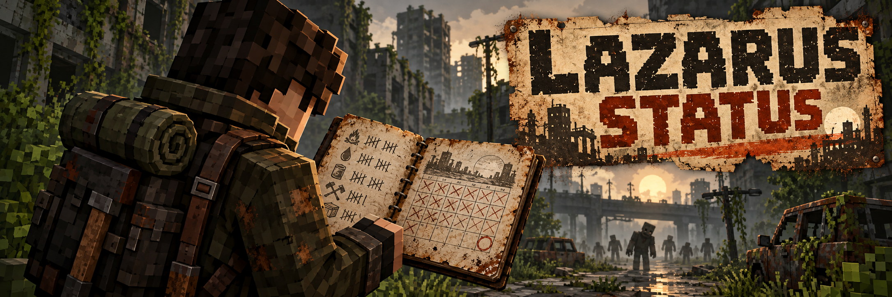

<p align="center">
  
</p>

<p align="center">
  
  
  
  
</p>

# Lazarus Status

**Lazarus Status** é um mod para Minecraft Forge 1.20.1 criado para o modpack **Project Lazarus**. Ele mantém uma ficha pessoal do sobrevivente: há quanto tempo você está vivo, quantos zumbis matou e qual foi seu melhor recorde. A ficha se abre por um pequeno botão no inventário, sem acrescentar informações permanentes ao HUD.

O mundo continua avançando depois de cada morte. Sua tentativa atual recomeça, enquanto o histórico pessoal permanece. Assim, cada saída da base ganha um registro sem transformar a exploração em uma tela de números.

> Os textos dentro do jogo são em inglês, seguindo o padrão do modpack.

---

## Sumário

- [Ficha do sobrevivente](#ficha-do-sobrevivente)
- [Como os dados são contados](#como-os-dados-são-contados)
- [Zumbis reconhecidos](#zumbis-reconhecidos)
- [Instalação](#instalação)
- [Créditos e licença](#créditos-e-licença)

---

## Ficha do sobrevivente

Abra o inventário e clique no **rosto do sobrevivente**, ao lado dos outros botões. A ficha usa a aparência de um documento gasto do apocalipse. **Back** ou **Esc** retorna ao inventário.

| Campo no jogo | O que mostra | Ao morrer |
|---|---|---|
| **World Day** | Dia atual do mundo principal (*Overworld*) | Continua avançando |
| **Days survived** | Dias e horas vividos na tentativa atual | Zera |
| **Zombies killed** | Zumbis mortos na tentativa atual | Zera |
| **Longest run** | Maior tempo sobrevivido em uma tentativa | Permanece |
| **Total zombies killed** | Soma dos zumbis mortos pelo jogador | Permanece |
| **Deaths** | Número de mortes do jogador desde a instalação do mod | Permanece |

Os dados são individuais e ficam salvos com o personagem no mundo. A ficha não mostra estatísticas de outros jogadores.

---

## Como os dados são contados

- **World Day** usa o relógio do Overworld: um dia equivale a 24.000 *ticks* de jogo. Ele mede a idade do mundo, não a idade do personagem.
- **Days survived** conta o tempo no mundo enquanto o jogador está conectado e em Sobrevivência ou Aventura. Tempo desconectado e tempo em Criativo ou Espectador não contam.
- Dormir adianta o relógio do mundo e conta para o tempo sobrevivido enquanto o jogador está conectado.
- A morte zera apenas os dados da tentativa atual. Viajar para outra dimensão não zera a ficha.
- Uma atualização vinda da versão 1.0.x preserva os dias completos sobrevividos e os abates da tentativa atual. As horas parciais e mortes anteriores não podem ser reconstruídas.

### Zumbis reconhecidos

O contador usa os abates atribuídos ao jogador. Uma morte cancelada por outro mod não entra na conta.

| Origem | Entidades contadas |
|---|---|
| **Minecraft** | Zombie, Husk, Drowned e Zombie Villager |
| **Apocalypse Now** | Variantes numeradas de Walker, Runner e Crawler |
| **Undead Revamped** | Heavy, Bomber, Spitter, Smoker, Hunter e Sucker |

Apocalypse Now e Undead Revamped são integrações opcionais: se estiverem instalados, seus zumbis são reconhecidos automaticamente. O Lazarus Status funciona sem o Lazarus Moodles.

---

## Instalação

### Requisitos

- **Minecraft 1.20.1**
- **Minecraft Forge 47.x** (desenvolvido com o 47.4.10)
- **Java 17**

### Jogadores e servidores

1. Obtenha o JAR do Lazarus Status distribuído com o Project Lazarus ou [compile o projeto](#compilar-a-partir-do-código).
2. Coloque o JAR na pasta `mods` do perfil. No CurseForge, clique com o botão direito no perfil e escolha **Open Folder**.
3. Em multiplayer, coloque o **mesmo JAR** na pasta `mods` do servidor e de todos os clientes.
4. Remova qualquer JAR antigo `lazarusstatus` antes de instalar uma atualização. Feche o Minecraft e reinicie o cliente e o servidor após a troca.

### Compilar a partir do código

Com JDK 17 instalado, execute na raiz do projeto:

```bash
gradlew build
```

O JAR fica em `build/libs/`. O build também executa a verificação do cálculo de dias e horas.

---

## Créditos e licença

- Desenvolvido por **Kaique Melo** para o **Project Lazarus**.
- Arte do painel e ícone do sobrevivente: originais do projeto.
- Banner: arte gerada com IA para o Lazarus Status.
- Não é afiliado à Mojang ou à Microsoft.

**Licença:** All Rights Reserved.
